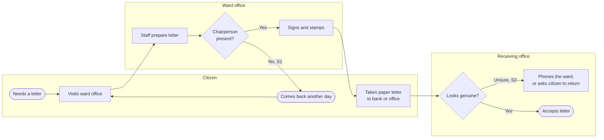

# Feasibility Study: Digital Recommendation Letters (Sifaris)

**Author:** Basant Tamang · **Date:** 30 October 2026 · **Version:** 1.0
*A self-initiated case study. Figures are estimates for discussion, not a costed proposal.*

> **In simple words:** ward offices give recommendation letters on paper. They need the chairperson's signature, and the chairperson is often away. The offices that receive the letters, such as banks, can't easily check that a letter is real. This study asks: should letters go digital, and which way is best? I compared four options, scored them, and recommend doing a cheap fix now and testing a digital letter in one ward first.

## 1. Summary and recommendation

**Recommendation: a phased approach.**

1. **Now (month 1):** introduce a numbered, recorded paper letter in every ward (Option A). It's cheap and makes letters checkable straight away.
2. **Pilot (months 2–4):** test a **QR-verifiable digital letter** (Option B) in one ward. The chairperson signs digitally from anywhere, and receiving offices scan a QR code to check the letter is real.
3. **Decide (month 5):** roll Option B out to all 32 wards **only if** the pilot shows it reduces return trips and is used by receiving offices.

**Why not go straight to Option B?** It scored highest (3.75 out of 5), but only just ahead of Option A (3.60). If cost matters slightly more than assumed, Option A wins (section 6). A pilot gives the evidence needed to decide, at low risk.

## 2. The problem

| ID | Problem | Evidence |
|---|---|---|
| S1 | Citizens can't get a letter when the signing officer is absent, so they make extra trips | **Confirmed** in interviews (Project 1, P10: "Sometimes the boss is not there to sign") |
| S2 | Receiving offices (banks, district offices, schools) can't easily check whether a letter is genuine | **Assumed**: needs confirmation from a receiving office |
| S3 | Fake or altered paper letters may be accepted | **Assumed**: needs evidence of how often this happens |
| S4 | Ward offices keep no searchable record of letters issued | **Assumed**: confirm with ward staff |

S1 is the only problem confirmed by evidence so far. This is a key reason the recommendation starts with a pilot.

## 3. How it works today (as-is)

## 4. Goal and scope

**Goal:** a citizen can get a valid recommendation letter in **one visit**, and a receiving office can confirm it's genuine in **under 1 minute**.

**Success measures (for the pilot):**

| Measure | Today (to be measured) | Pilot target |
|---|---|---|
| Visits needed to get a letter | [measure in pilot ward] | 1 visit for 90% of letters |
| Time for a receiving office to verify a letter | [measure] | Under 1 minute |
| Letters issued with a record in the system | [measure] | 100% |

**In scope:** recommendation letters issued by ward offices; how they are signed, recorded and verified.
**Out of scope:** other documents (birth certificates, citizenship); payment of fees; changing which letters wards are allowed to issue.

## 5. The options

| Option | What it is | How it helps |
|---|---|---|
| **0. Do nothing** | Keep today's process | Baseline for comparison only |
| **A. Improved paper register** | Every letter gets a printed serial number and is recorded in a ward register (Excel or simple database). A receiving office can phone or check a list to confirm the number | Letters become traceable; very cheap. Still needs a wet signature, so S1 isn't solved |
| **B. QR-verifiable digital letter** | Staff prepare the letter in a web system. The chairperson approves it with a **digital signature** from a phone or laptop, even when away. The citizen gets a printed letter with a **QR code**; scanning it opens the official copy on a ward verification page | Solves S1 (sign from anywhere), S2 and S3 (verification by scan), S4 (every letter recorded) |
| **C. National app integration** | Letters are issued into the citizen's national government app account and shared from there | Strong verification, but needs agreement with central government, a long timeline, and excludes citizens without smartphones |

**Note on Option C:** the government's Nagarik App already offers about 25 central services, such as PAN registration and police reports, plus a "My Municipality" section with contact details and plans. Ward-level recommendation letters aren't among its services today ([Wikipedia: Nagarik App](https://en.wikipedia.org/wiki/Nagarik_App)). Adding them would need central agreement.

## 6. Comparison

Each option is scored **1 (poor) to 5 (good)** on each criterion. Criteria are weighted by importance. Full scores: [scoring/options-scoring.csv](../scoring/options-scoring.csv).

| Criterion | Weight | 0. Do nothing | A. Paper register | B. QR digital | C. National app |
|---|---|---|---|---|---|
| Stops fake or altered letters (S3) | 20% | 1 | 2 | 5 | 5 |
| Fewer return trips when the signer is absent (S1) | 20% | 1 | 1 | 4 | 4 |
| Cost to build and run | 15% | 5 | 5 | 3 | 2 |
| Time to deliver | 10% | 5 | 5 | 3 | 1 |
| Technical risk | 10% | 5 | 5 | 3 | 2 |
| Works for citizens without smartphones | 15% | 5 | 5 | 4 | 2 |
| Staff training needed | 10% | 5 | 5 | 3 | 3 |
| **Weighted total (out of 5)** | 100% | **3.40** | **3.60** | **3.75** | **3.00** |

**Why these weights:** the two problems the study exists to solve (S1 and S3) carry 40% between them. Inclusion carries 15% because many citizens may not have smartphones (a Project 1 assumption, not yet confirmed).

**Why B scores 4, not 5, for smartphones:** the citizen still gets a **printed** letter; only the receiving office needs a phone to scan it.

### How sure is this result? (sensitivity check)

| Change to the weights | A. Paper | B. QR digital | Winner |
|---|---|---|---|
| As above | 3.60 | **3.75** | B |
| Move 5% from "fake letters" to "cost" | **3.75** | 3.65 | A |
| Move 10% from "fake letters" to "cost" | **3.90** | 3.55 | A |
| All criteria weighted equally | **4.00** | 3.57 | A |

**What this tells us:** B wins only if stopping fake letters and avoiding return trips really are the top priorities. That depends on S2 and S3, which are **not yet confirmed**. So the right next step is to **gather evidence through a pilot**, not to commit to a full rollout.

## 7. Legal and policy check

| Question | What we know | Status |
|---|---|---|
| Are electronic records legally recognised in Nepal? | The Electronic Transactions Act, 2063 (2008) was passed to give legal recognition, validity and reliability to electronic records and transactions ([Nepal Law Commission](https://www.lawcommission.gov.np/en/?p=16954); [UNODC copy](https://sherloc.unodc.org/cld/uploads/res/document/the-electronic-transactions-act-_html/Nepal_Electronic_Transactions_Act.pdf)) | Supports Option B |
| Can a ward chairperson sign a letter digitally? | The Act provides for digital signatures through licensed certifying authorities ([overview](https://boldsign.com/electronic-signature-legality/nepal/)) | **To confirm** with the municipality's legal section |
| Will banks and offices accept a QR-verified letter? | Unknown | **To confirm** during the pilot |
| Can someone else sign when the chairperson is away? | A municipal decision (see Project 1, SRS section 8) | **To confirm** |

## 8. High-level requirements for Option B

| ID | Requirement |
|---|---|
| HLR-01 | Every letter shall have a unique number in the format ward–year–sequence. |
| HLR-02 | Staff shall prepare letters from approved templates, one per letter type. |
| HLR-03 | The signing officer shall be able to review and digitally sign a letter from a phone or laptop, from any location. |
| HLR-04 | If the signing officer is unavailable, a pre-approved delegate shall be able to sign, and the letter shall show who signed. |
| HLR-05 | Each printed letter shall carry a QR code linking to its official copy on a public verification page. |
| HLR-06 | The verification page shall show the letter's number, type, date, the citizen's name, who signed, and whether it is still valid, and nothing more. |
| HLR-07 | A letter shall be cancellable by the ward; the verification page shall then show "Cancelled". |
| HLR-08 | Every action (prepare, sign, print, cancel, verify) shall be recorded in an audit log that can't be edited. |
| HLR-09 | Citizens without a smartphone shall receive a printed letter that is valid without any app. |
| HLR-10 | The verification page shall load within 3 seconds on a mobile connection. |

## 9. Rollout and rough estimate

Estimates are **rough order of magnitude (±50%)**, in person-weeks of effort.

| Phase | When | What | Effort |
|---|---|---|---|
| 0. Quick win | Month 1 | Numbered letters and a register in all 32 wards (Option A) | 2 person-weeks |
| 1. Pilot | Months 2–4 | Detailed requirements, build Option B, legal sign-off, train one ward and 3–5 receiving offices | 16 person-weeks |
| 2. Decide | Month 5 | Measure against success measures; decide on rollout | 1 person-week |
| 3. Rollout | Months 6–9 | Train all wards; support; publicise verification to banks and offices | 10 person-weeks |
| **Total** | **9 months** | | **29 person-weeks** |

## 10. Risks

| ID | Risk | Likelihood | Impact | Response |
|---|---|---|---|---|
| K1 | Digital signatures not accepted for ward letters under current rules | Medium | High | Get a legal opinion before building (Phase 1, week 1) |
| K2 | Receiving offices don't scan the QR code and keep phoning | Medium | Medium | Involve 3–5 receiving offices in the pilot; short guide for them |
| K3 | Chairperson unwilling to sign on a phone | Low | High | Involve them in the design; allow a delegate (HLR-04) |
| K4 | Ward internet or power fails (as in Project 1, P9) | High | Medium | Letters can be prepared offline and signed when connected; paper fallback stays |
| K5 | Fraud with fake QR codes linking to look-alike sites | Low | High | Verification only on the official government domain; publicise it |

## 11. Change impact analysis

| Who is affected | What changes for them | Impact | Support needed |
|---|---|---|---|
| Citizens | One visit instead of possible return trips; letter has a QR code | Positive | Short notice at the ward explaining the new letter |
| Ward staff | Prepare letters in a system instead of by hand; record every letter | Medium: new skill | Half-day training; quick-reference card |
| Ward chairperson | Signs digitally, possibly remotely; can delegate | Medium: new way of working | One-to-one setup and practice |
| Receiving offices | Scan the QR code instead of phoning the ward | Positive, but a new habit | One-page guide; contact for questions |
| Existing paper records | Old letters stay valid; only new letters are digital | Low | Clear cut-over date |
| Municipality IT | Hosts and maintains the system and verification page | Medium: new service | Hosting budget; support rota |
| Law and policy | May need a municipal decision on digital signing and delegation | High if missing | Legal opinion; council decision |

## 12. Open questions

1. How often are fake or altered letters actually found? (Decides the weight of S3)
2. Will banks and district offices accept a QR-verified letter?
3. Who is legally allowed to sign when the chairperson is away?
4. What computer system do wards use today? (Project 1, assumption A3)

## Sources

- Nepal Law Commission, [The Electronic Transactions Act, 2063 (2008)](https://www.lawcommission.gov.np/en/?p=16954)
- UNODC SHERLOC, [Nepal Electronic Transactions Act (full text)](https://sherloc.unodc.org/cld/uploads/res/document/the-electronic-transactions-act-_html/Nepal_Electronic_Transactions_Act.pdf)
- BoldSign, [Legality of eSignatures in Nepal](https://boldsign.com/electronic-signature-legality/nepal/)
- Wikipedia, [Nagarik App](https://en.wikipedia.org/wiki/Nagarik_App)
- Project 1, [Ward Office Appointment System interview notes](https://github.com/basanttamang/ward-appointment-system/blob/main/docs/02-interview-notes.md)
